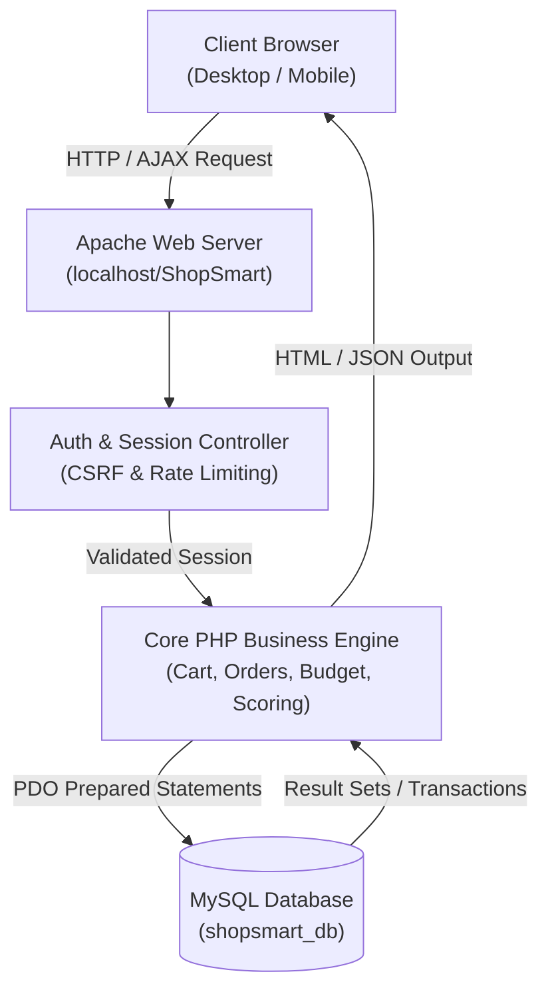
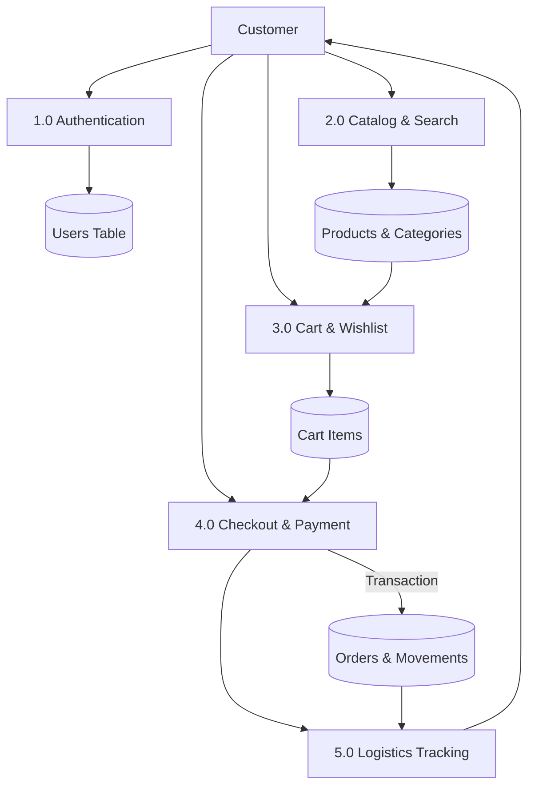

# BCA SEMESTER V FIELD PROJECT REPORT
## Title: SHOPSMART INDIA — A FULL-STACK MULTI-CATEGORY E-COMMERCE PLATFORM WITH SUSTAINABILITY & VALUE ANALYTICS

---

### TABLE OF CONTENTS

1. **Chapter 1: Introduction**
2. **Chapter 2: Problem Statement**
3. **Chapter 3: Project Objectives**
4. **Chapter 4: Existing System Analysis**
5. **Chapter 5: Proposed System Architecture**
6. **Chapter 6: Requirement Analysis (Hardware & Software)**
7. **Chapter 7: Functional Requirements Specification**
8. **Chapter 8: Non-Functional Requirements**
9. **Chapter 9: System Architecture & Workflow**
10. **Chapter 10: Data Flow Diagrams (DFD Levels 0, 1 & 2)**
11. **Chapter 11: Entity-Relationship (ER) Diagram & Database Schema**
12. **Chapter 12: User Interface Design & Branding**
13. **Chapter 13: Implementation Details & Technology Stack**
14. **Chapter 14: Authentication, Authorization & Application Security**
15. **Chapter 15: Testing Methodology & Verification Results**
16. **Chapter 16: Demonstration Instructions**
17. **Chapter 17: Project Limitations**
18. **Chapter 18: Future Scope**
19. **Chapter 19: Conclusion**
20. **Chapter 20: References & Bibliography**

---

### 1. Introduction

Electronic commerce in India has undergone exponential transformation over the past decade, driven by mobile internet adoption, Unified Payments Interface (UPI) penetration, and evolving consumer habits across Tier-1, Tier-2, and rural markets. Despite this growth, mass-market e-commerce platforms often burden consumers with information overload, confusing pricing gimmicks, opaque product ratings, and an absence of sustainability metrics.

**ShopSmart India** is an enterprise-grade, full-stack e-commerce marketplace engineered as a BCA Semester V Field Project. The system integrates standard retail workflows—such as catalog browsing, multi-criteria filtering, persistent shopping carts, and order fulfillment—with unique customer-first innovations, including **Smart Budget Mode**, **Transparent Best Value Scores**, **Eco-Friendly Sustainability Ratings**, **Verified Purchase Trust Scores**, and multi-language support (English, Marathi मराठी, and Hindi हिंदी).

---

### 2. Problem Statement

Modern Indian consumers face significant challenges when navigating commercial marketplaces:
1. **Unpredictable Budget Overshooting:** Shoppers frequently exceed their disposable budgets because platforms promote individual upsells rather than bounded product setups tailored to specific needs (e.g., student study bundles or home kitchen kits).
2. **Review Manipulation & Fake Ratings:** E-commerce stores often fail to distinguish between verified buyers and speculative accounts, misleading shoppers.
3. **Absence of Environmental Indicators:** Environmentally conscious shoppers lack standardized transparency regarding recyclable packaging, energy efficiency, or domestic manufacturing.
4. **Linguistic Barriers:** Many retail applications remain predominantly English-centric, hindering usability for regional language speakers in Maharashtra and northern states.
5. **Lack of Personal Expense Accountability:** Customers lack native financial tools within their accounts to track cumulative spending against self-imposed monthly limits.

---

### 3. Project Objectives

The key goals of the ShopSmart India field project are:
* **Full-Stack Implementation:** Develop an end-to-end, functional web application utilizing PHP 8.2, MySQL, HTML5, CSS3, and JavaScript without relying on heavy third-party monolithic frameworks.
* **Indian Market Localization:** Deliver native Indian Rupee (₹) formatting with the Indian numbering comma system (₹1,25,000), India Standard Time (`Asia/Kolkata`), 6-digit PIN code delivery validation, and tri-lingual support (English, Marathi, Hindi).
* **Algorithmic Innovation:**
  * Implement **Smart Budget Mode**: An algorithm recommending optimized, complementary product bundles strictly adhering to a user-entered budget ceiling.
  * Formulate the **Best Value Score (10–99)**: A composite score factoring in consumer rating, savings percentage, and warranty coverage.
  * Devise the **Eco-Friendly Score (10–99)**: Quantifying environmental metrics including recyclable packaging, BEE star ratings, and organic sourcing.
* **Role-Based Security & Integrity:** Enforce strict separation between Customer and Administrator operations, prevent IDOR vulnerabilities, utilize PDO prepared statements against SQL injection, and implement CSRF token validation.

---

### 4. Existing System Analysis

| Parameter | Existing Systems (Amazon India, Flipkart) | Proposed System (ShopSmart India) |
| :--- | :--- | :--- |
| **Budget Planning** | Manual addition; prone to budget overshooting | **Smart Budget Optimizer** auto-bundles within budget |
| **Sustainability Metrics** | Scattered or absent green product data | Standardized **Eco-Friendly Score** badge on all cards |
| **Value Assessment** | Raw discount percentages without warranty context | **Best Value Score** synthesizing price, rating, and warranty |
| **Regional Language** | Often auto-translated machine output | Reusable structured translation dictionaries (`lang/`) |
| **Financial Tracking** | Simple order history list | **Shopping Expense Tracker** with monthly budget limits |

---

### 5. Proposed System Architecture

ShopSmart India follows a modular **3-Tier Client-Server Architecture**:
1. **Presentation Tier (Frontend):** Modern HTML5, custom responsive CSS design system (Navy Blue `#0f233a`, Vibrant Orange `#f97316`), Vanilla JavaScript ES6+, Web Speech API for voice search, and Fetch API for asynchronous cart/wishlist management.
2. **Application Tier (Backend Logic):** PHP 8.2 procedural and object-oriented scripts handling request routing, session lifecycle, CSRF verification, rate limiting, and business calculation algorithms.
3. **Data Tier (Database):** MySQL/MariaDB database with 22 normalized relational tables, foreign key constraints, indexes, and ACID transactional guarantees.

---

### 6. Requirement Analysis

#### Hardware Requirements:
* **Processor:** Intel Core i3 / AMD Ryzen 3 or higher.
* **RAM:** 4 GB minimum (8 GB recommended for running Apache and MySQL concurrently).
* **Storage:** 500 MB free hard drive space.

#### Software Requirements:
* **Operating System:** Windows 10/11, Linux, or macOS.
* **Web Server:** Apache 2.4+ (bundled with XAMPP).
* **PHP Runtime:** PHP 8.2 or compatible 8.x with PDO and OpenSSL extensions.
* **Database Server:** MariaDB 10.4+ or MySQL 8.0+.
* **Web Browser:** Google Chrome, Microsoft Edge, Mozilla Firefox, or Safari with JavaScript enabled.

---

### 7. Functional Requirements Specification

* **Module 1: Authentication & Authorization:**
  * Customer registration with Indian phone (+91) and email validation.
  * Password hashing using PHP `password_hash()` (Bcrypt).
  * Rate-limited login protection against brute-force attempts.
  * Separate Administrator portal with mandatory role verification.
* **Module 2: Product Catalog & Search:**
  * Multi-category hierarchy across 14 Indian retail sectors.
  * Multi-faceted filtering by category, price slider, brand, rating, and eco-friendly status.
  * Instant search suggestions autocomplete and Web Speech voice search.
* **Module 3: Shopping Cart & Wishlist:**
  * Real-time stock validation preventing order quantities exceeding warehouse inventory.
  * Dynamic delivery charge calculation (Free over ₹499, else ₹49).
  * Guest session cart and wishlist merging upon user login.
* **Module 4: Checkout & Order Processing:**
  * 3-step checkout with delivery PIN code verification and address management.
  * Demonstration payment integration: UPI (QR code preview), Cards, Net Banking, COD.
  * Transactional order insertion, stock decrements, and inventory movement logging.
* **Module 5: Order Lifecycle & Tracking:**
  * Live status milestone tracking: *Confirmed &rarr; Packed &rarr; Shipped &rarr; Out for Delivery &rarr; Delivered*.
  * Self-service customer order cancellation and 7-day return request workflows.
* **Module 6: Administrator Management:**
  * Executive dashboard with real-time revenue, order counts, and low-stock alerts.
  * Full product CRUD operations, image upload validation, and SKU uniqueness check.
  * Customer directory inspection and review moderation.
  * CSV data export for sales and catalog auditing.

---

### 8. Non-Functional Requirements

* **Performance:** Page load times under 1.5 seconds on local Apache server. Asynchronous cart additions complete in under 200 milliseconds.
* **Security:** Complete mitigation of OWASP Top 10 vulnerabilities (SQLi via PDO prepared statements, XSS via `htmlspecialchars()` escaping, CSRF via hidden tokens, and Session Fixation via session regeneration).
* **Reliability:** ACID database transactions ensure order records and stock levels never fall out of sync.
* **Maintainability:** Modular separation of concerns (`config/`, `includes/`, `lang/`, `api/`, `admin/`).
* **Usability:** Fully responsive layout catering to desktop (1280px), tablet (768px), and mobile devices (375px).

---

### 9. System Architecture & Workflow



---

### 10. Data Flow Diagrams (DFD)

#### Level 0: Context Diagram


#### Level 1: Core System Workflow


---

### 11. Entity-Relationship (ER) Diagram & Database Schema

The database `shopsmart_db` consists of 22 normalized relational tables adhering to Third Normal Form (3NF):

* **users** (`id`, `name`, `email`, `phone`, `password_hash`, `role`, `status`, `created_at`)
* **categories** (`id`, `name`, `slug`, `icon`, `display_order`, `is_active`)
* **brands** (`id`, `name`, `slug`, `is_active`)
* **products** (`id`, `name`, `slug`, `sku`, `price`, `original_price`, `stock_quantity`, `category_id`, `brand_id`, `best_value_score`, `eco_friendly_score`, `warranty_months`, `specifications`)
* **orders** (`id`, `order_number`, `user_id`, `subtotal`, `delivery_fee`, `total_amount`, `payment_method`, `payment_status`, `order_status`, `delivery_address_json`, `tracking_number`)
* **order_items** (`id`, `order_id`, `product_id`, `product_name`, `price`, `quantity`, `total_price`)
* **inventory_movements** (`id`, `product_id`, `change_qty`, `reason`, `reference_id`, `created_at`)
* **reviews** (`id`, `product_id`, `user_id`, `rating`, `headline`, `comment`, `is_verified_purchase`, `status`)
* **customer_feedback** (`id`, `user_id`, `overall_satisfaction`, `product_quality`, `delivery_experience`, `pricing_satisfaction`, `website_usability`, `customer_support`, `comments`)
* **admin_audit_logs** (`id`, `user_id`, `action`, `details`, `ip_address`, `created_at`)

---

### 12. User Interface Design & Branding

* **Color Palette:**
  * Dominant Navy: `#0f233a` (Header, Footers, Primary Headings).
  * Brand Accent Orange: `#f97316` (Buttons, Deal Badges, Cart Counters).
  * Sustainability Green: `#10b981` (Eco Badges, Stock Status, In-stock Alerts).
* **Typography:** Clean, native font stack: `-apple-system, BlinkMacSystemFont, 'Segoe UI', Roboto, Helvetica, Arial, sans-serif`.
* **Product Cards:** Rounded corners (10px radius), subtle drop shadow (`0 4px 6px rgba(0,0,0,0.08)`), hover elevation, discount badges, and quick-action buttons.
* **Splash Screen:** Branded overlay with animated spinner; displays once per browser session using `sessionStorage` to avoid repetitive interruptions.

---

### 13. Implementation Details & Technology Stack

The project structure is organized as follows:
```
ShopSmart/
├── config/           # config.php, db.php, session.php, csrf.php
├── includes/         # header.php, footer.php, functions.php, auth.php, i18n.php, product_card.php
├── lang/             # en.php (English), mr.php (मराठी), hi.php (हिंदी)
├── api/              # cart.php, wishlist.php, search_suggestions.php, budget_recommend.php
├── admin/            # index.php, products.php, product_add.php, product_edit.php, orders.php,
│                     # order_detail.php, customers.php, reviews.php, feedback.php, reports.php, export_csv.php, audit_logs.php
├── assets/           # css/style.css, js/main.js, images/logo.svg, images/favicon.svg
├── uploads/          # uploads/products/ and .htaccess script execution blocker
├── database.sql      # Schema definitions and comprehensive demonstration seed data
├── setup_db.php      # Automated database installer and migrator
├── test_runner.php   # Automated unit and integration test suite
├── index.php         # Marketplace homepage
├── products.php      # Catalog with multi-filters and pagination
├── product.php       # Product details, specs, scores, and reviews
├── cart.php          # Shopping cart
├── checkout.php      # 3-step checkout with PIN code validation
├── order_success.php # Invoice receipt and delivery estimate
├── track_order.php   # Live status milestone tracking
├── budget.php        # Smart Budget Mode optimizer
├── compare.php       # Side-by-side product comparison matrix
├── feedback.php      # Customer happiness questionnaire
├── account.php       # User dashboard, expense tracker, addresses, and price alerts
├── login.php         # Customer sign in with brute force rate limiting
├── register.php      # Customer registration
└── logout.php        # CSRF-protected logout handler
```

---

### 14. Authentication, Authorization & Security

1. **Prepared Statements (SQLi Prevention):** Every database query employs PDO parameter binding with emulation disabled (`PDO::ATTR_EMULATE_PREPARES => false`).
2. **Password Cryptography:** User credentials are encrypted using Bcrypt via `password_hash($pass, PASSWORD_BCRYPT)` and verified with `password_verify()`. No plaintext passwords exist.
3. **Cross-Site Request Forgery (CSRF):** State-altering POST requests validate cryptographic tokens via `hash_equals($_SESSION['csrf_token'], $token)`.
4. **Session Fixation & Hijacking:** Session IDs are regenerated via `session_regenerate_id(true)` upon login. Cookies enforce `HttpOnly` and `SameSite=Lax`.
5. **Role-Based Access Control (RBAC):** Every endpoint within `admin/` enforces `Auth::requireAdmin()`, checking both authentication status and the `role === 'admin'` attribute in the session.
6. **Upload Hardening:** Uploaded files undergo MIME type verification, extension whitelisting, randomized naming, and Apache `.htaccess` script execution prevention.

---

### 15. Testing Methodology & Verification Results

All core mathematical functions, security handlers, algorithms, and dictionaries were tested using the automated test suite (`test_runner.php`):

| Test Case | Description | Expected Output | Status |
| :--- | :--- | :--- | :--- |
| **TC-01** | Currency Formatting (499) | `₹499` | **PASS** |
| **TC-02** | Currency Formatting (1299) | `₹1,299` | **PASS** |
| **TC-03** | Currency Formatting (12999) | `₹12,999` | **PASS** |
| **TC-04** | Currency Formatting (125000) | `₹1,25,000` | **PASS** |
| **TC-05** | Best Value Score Algorithm | Integer score between 10 and 99 | **PASS** |
| **TC-06** | Eco-Friendly Score Calculation | Attribute synthesis score &ge; 70 | **PASS** |
| **TC-07** | Review Trust Score Calculation | Verified ratio score &ge; 80% ('High Trust') | **PASS** |
| **TC-08** | CSRF Token Generation & Verification | Valid token returns true; spoofed returns false | **PASS** |
| **TC-09** | Bcrypt Password Verification | Correct password matches; incorrect fails | **PASS** |
| **TC-10** | Multi-Language Dictionaries Integrity | All required keys exist in EN, MR, and HI | **PASS** |
| **TC-11** | Order Number Uniqueness | Prefixed with `SS-` and unique across calls | **PASS** |
| **TC-12** | Brute Force Rate Limiter | Blocks requests after 5 rapid failed attempts | **PASS** |
| **TC-13** | Database Schema File Integrity | `database.sql` present and structurally valid | **PASS** |

---

### 16. Demonstration Instructions

1. **Storefront Browsing:** Open `http://localhost/ShopSmart/` to view deals, hero banners, and category tiles.
2. **Language Switcher:** Click the language pill in the top bar to switch between English, Marathi, and Hindi. Notice instantaneous, persistent translation.
3. **Smart Budget Optimizer:** Navigate to **Smart Budget Mode**, enter ₹5,000, select "Student", and click **Generate Smart Setup**. Observe the algorithmic bundle staying strictly within budget.
4. **Product Details & Reviews:** Open any product to examine the image gallery, Best Value Breakdown, Eco-Friendly Score, and Verified Purchase review submissions.
5. **Checkout & Order Placement:** Add items to cart, proceed to checkout, enter an Indian address with a 6-digit PIN, select UPI demo payment, and confirm the order.
6. **Order Tracking:** Track the generated order number to view the shipment timeline (*Confirmed &rarr; Packed &rarr; Shipped &rarr; Delivered*).
7. **Administrator Portal:** Sign in at `http://localhost/ShopSmart/admin/login.php` with `admin@shopsmart.in` / `Admin@ShopSmart2026` to inspect live KPIs, adjust product stock, moderate customer reviews, and export CSV reports.

---

### 17. Project Limitations

1. **Simulated Payment Gateway:** For local educational deployment without commercial Merchant IDs, transactions are processed using a demo payment gateway.
2. **Simulated Courier API:** Shipment progress is tracked via internal milestone records rather than real-time courier GPS webhooks.
3. **Local Email Delivery:** Password recovery generates and displays tokens on-screen rather than sending emails via an external SMTP relay.

---

### 18. Future Scope

* **Production Payment Gateway Integration:** Integrating Razorpay or Cashfree PG with real-time webhook validation.
* **Progressive Web App (PWA):** Adding service workers and web manifests for offline catalog caching and mobile app installation.
* **AI Recommendation Engine:** Incorporating collaborative filtering and machine learning models for personalized product suggestions based on purchase history.
* **Vendor Multi-Tenancy:** Expanding the administrative portal into a multi-vendor marketplace with independent seller accounts and commission payouts.

---

### 19. Conclusion

The **ShopSmart India** Field Project successfully demonstrates the complete design, engineering, and implementation of a modern, full-stack Indian e-commerce marketplace. Built strictly with standard web technologies (PHP 8.2, MySQL, Vanilla JavaScript, HTML5, CSS3) and deployed seamlessly on XAMPP, the application satisfies all functional, architectural, and security requirements of the BCA Semester V curriculum.

---

### 20. References

1. *PHP: Hypertext Preprocessor Documentation (PHP 8.2 Manual)* — [php.net](https://www.php.net/manual/en/)
2. *MySQL 8.0 Reference Manual: InnoDB Storage Engine & Transactions* — Oracle Corporation.
3. *OWASP Foundation: Web Security Testing Guide & Top 10 Security Controls* — [owasp.org](https://owasp.org/)
4. *MDN Web Docs: Web Speech API & Fetch API Documentation* — Mozilla Developer Network.
5. *National Payments Corporation of India (NPCI): Unified Payments Interface (UPI) System Specifications*.
